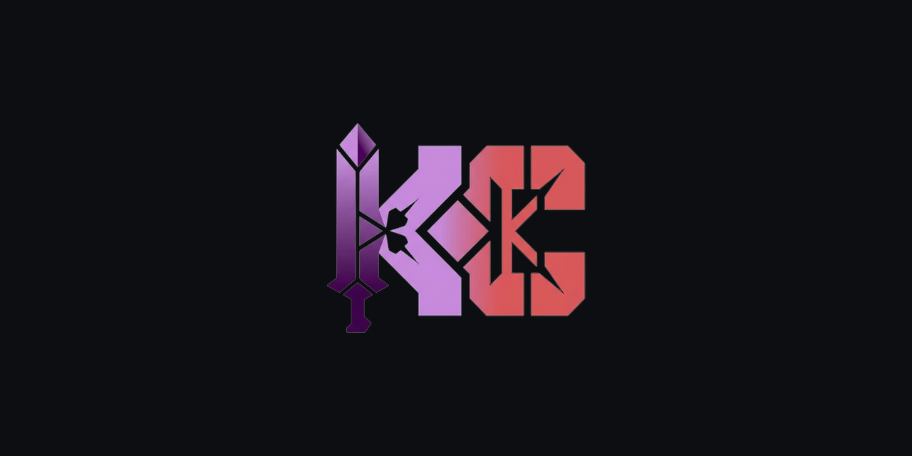

<a id="top"></a>

<div align="center">



<h1>baseline-sandbox</h1>

<p><strong>Banco de pruebas de las plantillas de repo-bootstrap: nada se publica sin haberse ejecutado.</strong></p>

<p>
  
  
</p>

<p>
<a href="#que-hace"><strong>Qué hace</strong></a> &bull;
<a href="#como-se-usa"><strong>Cómo se usa</strong></a> &bull;
<a href="#que-no-es"><strong>Qué no es</strong></a>
</p>

</div>

---

<p>
Un banco de pruebas para las plantillas de <a href="https://github.com/KapsCa/kkapsca-skills">kkapsca-skills</a>.
Una plantilla que nunca se ejecutó no está verificada: este repositorio existe para que cada una corra de
verdad, en un repositorio real, con la protección de rama y los checks funcionando, antes de publicarse.
</p>

## Qué hace

- Recibe cada plantilla nueva de `repo-bootstrap` y la aplica sobre un repositorio real.
- Empuja los cambios y observa si los workflows pasan.
- Sirve de referencia de lo que un repositorio recién bootstrapeado debe mostrar: checks verdes, etiquetas,
  plantilla de PR, y el header de marca.

## Cómo se usa

```bash
# sobre un clon de este repositorio
bash ~/.agents/skills/repo-bootstrap/assets/install-repo-standards.sh
```

Luego se revisa que los workflows del repositorio pasen: `dist-integrity`-equivalentes, gitleaks, audit y
CodeQL cuando corresponde. Si algo falla, la plantilla no está lista.

## Qué no es

No es un proyecto de producto ni una demo de nada. No tiene usuarios ni funcionalidad propia: si algo vive
acá, es porque sirve para verificar otra cosa.
